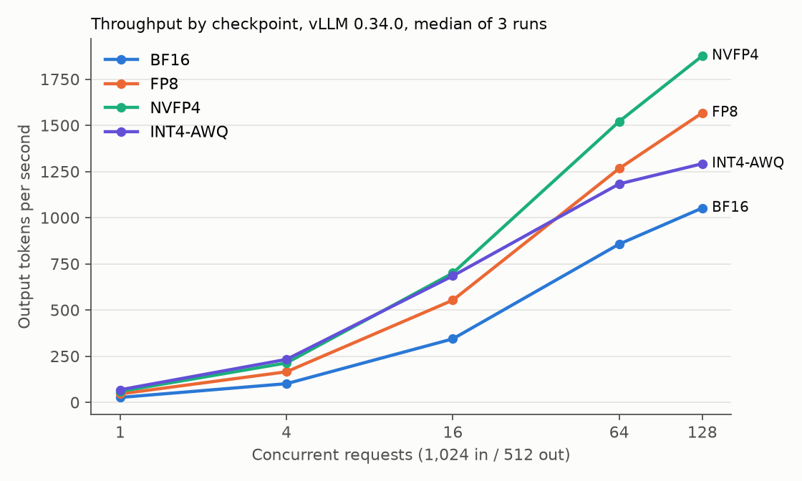

# FP8 vs NVFP4 vs AWQ: which Qwen3.8-27B checkpoint should you serve?

Spheron Research, study 1. Measured 23 Nov 2026 on one NVIDIA RTX PRO 6000 Blackwell Server Edition (96 GB) on Spheron. Version 1.

## Findings

- **NVFP4 serves the most traffic at the latency target, with no measurable accuracy loss.** At our latency target (20 tok/s per user, first token p95 under 2 s), `unsloth/Qwen3.8-27B-NVFP4` served 700 output tok/s at 16 concurrent users. BF16 met the target only at 4 users, at 101 tok/s. That is 6.9x the output per GPU for NVFP4.
- **None of the three quantized checkpoints lost a statistically significant amount of accuracy against BF16** on GSM8K, an MMLU-Pro subset, MATH-500 or IFEval. The largest drop was on MATH-500: FP8 -2.2 points, NVFP4 -2.0, INT4-AWQ -1.4. Each of those is inside two paired standard errors (about 2.4 to 2.8 points at 500 questions).
- **At full load NVFP4 also has the highest throughput:** 1,876 tok/s at 128 users, against 1,567 for FP8 (+20%), 1,292 for INT4-AWQ (+45%) and 1,052 for BF16 (+78%). It also used the least energy per token: 0.25 J per output token at 128 users, against 0.30 for FP8 and 0.40 for INT4-AWQ.
- **INT4-AWQ is the fastest for a single user (69 tok/s) but slowest to first token under load.** At 16 users its decode is quick (19 ms per token) but first-token p95 is 2.5 s, which misses the target. That limits it to 4 users at the target, at 233 tok/s, a third of what NVFP4 serves there.
- **Running the KV cache in FP8 had no measurable effect at 8k and 32k context.** FP8 weights with FP8 KV scored 96.1% on GSM8K (96.2% with BF16 KV). NVFP4 as shipped, which runs its own FP8 KV scheme, scored 95.8% (96.2% with BF16 KV). All six needle-retrieval tasks were 100% in every configuration. Those tasks turned out too easy to separate the formats, so treat this as "no loss found", not "no loss".

## Charts




## Results

### Quality

Accuracy in percent, thinking off, temperature 0. Change is the paired per-question difference against BF16, with two paired standard errors in brackets.

| Eval (questions) | BF16 | FP8 | NVFP4 | INT4-AWQ |
|---|---|---|---|---|
| GSM8K, 5-shot, strict match (1,319) | 96.1 | 96.2 (+0.1 ± 0.6) | 96.2 (+0.1 ± 0.7) | 96.1 (0.0 ± 0.8) |
| MMLU-Pro, 140 per subject (1,960) | 71.3 | 72.0 (+0.8 ± 1.3) | 71.4 (+0.1 ± 1.4) | 71.4 (+0.1 ± 1.4) |
| MATH-500, 4-shot, math-verify (500) | 78.4 | 76.2 (-2.2 ± 2.4) | 76.4 (-2.0 ± 2.8) | 77.0 (-1.4 ± 2.7) |
| IFEval, prompt-level strict (541) | 81.7 | 81.1 (-0.6 ± 2.0) | 83.5 (+1.8 ± 2.6) | 83.4 (+1.7 ± 2.6) |
| Needle retrieval, 6 tasks at 8k and 32k (600) | 100 | 100 | 100 | 100 |

KV cache check (GSM8K and needle retrieval only):

| Configuration | GSM8K strict | Needle retrieval |
|---|---|---|
| FP8 weights, BF16 KV (arm B) | 96.2 | 100 |
| FP8 weights, FP8 KV (arm E) | 96.1 (0.0 ± 0.6 vs BF16) | 100 |
| NVFP4 weights, BF16 KV (arm C) | 96.2 | 100 |
| NVFP4 as shipped, FP8 KV (arm F) | 95.8 (-0.3 ± 0.7 vs BF16) | 100 |

### Speed

Median of three repeats per level. Workload: random prompts, 1,024 tokens in, 512 out.

| Checkpoint | Weights on disk | 1 user, tok/s | Best load that meets target | Output tok/s there | Peak tok/s (128 users) |
|---|---|---|---|---|---|
| BF16 | 55.6 GB | 26.5 | 4 users | 101 | 1,052 |
| FP8 | 30.9 GB | 45.8 | 16 users | 553 | 1,567 |
| NVFP4 | 23.4 GB | 59.5 | 16 users | 700 | 1,876 |
| INT4-AWQ | 21.0 GB | 69.4 | 4 users | 233 | 1,292 |

Latency at 16 concurrent users, where the checkpoints split:

| Checkpoint | Output tok/s | First token p50 | First token p95 | Time per output token p50 | Meets target |
|---|---|---|---|---|---|
| BF16 | 344 | 1.80 s | 2.28 s | 43.1 ms | no (first token) |
| FP8 | 553 | 1.12 s | 1.44 s | 26.8 ms | yes |
| NVFP4 | 700 | 0.81 s | 1.05 s | 21.3 ms | yes |
| INT4-AWQ | 685 | 2.17 s | 2.53 s | 19.2 ms | no (first token) |

Energy, GPU board power from `nvidia-smi` every second, in joules per output token:

| Checkpoint | 1 user | 16 users | 128 users |
|---|---|---|---|
| FP8 | 7.14 | 0.67 | 0.30 |
| NVFP4 | 5.57 | 0.53 | 0.25 |
| INT4-AWQ | 5.23 | 0.64 | 0.40 |

BF16 energy was not recorded (see deviations).

Every level for every arm, with min and max across repeats, is in `results/throughput_summary.csv`. Repeats agreed within 0.2%.

## What we did

- **GPU:** 1x NVIDIA RTX PRO 6000 Blackwell Server Edition, 96 GB, driver 580.196.07, CUDA 13.0. Spheron, dedicated (not spot).
- **Engine:** vLLM 0.34.0 (torch 2.14.0, transformers 5.22.2). One server per configuration with `--max-model-len 40960 --max-num-seqs 256 --seed 0 --disable-prefix-caching`, text only, `enable_thinking: false`. KV cache forced to BF16 for arms A to D. The NVFP4 checkpoint ships an FP8 KV scheme, and vLLM picks it up by default. Exact command in `harness/run_arm.sh`.
- **Checkpoints, pinned by commit:**
  - A `Qwen/Qwen3.8-27B` `37561816e66b`
  - B `Qwen/Qwen3.8-27B-FP8` `c3a462cc3d38`
  - C `unsloth/Qwen3.8-27B-NVFP4` `f0b7c9e722f5`
  - D `cyankiwi/Qwen3.8-27B-AWQ-INT4` `e3a700906e6a`
  - E is B's weights with an FP8 KV cache; F is C as shipped.
- **Evals:** lm-evaluation-harness 0.4.13 through `local-chat-completions` against the same vLLM server we benchmarked. Chat template applied, few-shot as multi-turn, temperature 0, one pass.
  - GSM8K, 5-shot, 512 max tokens
  - MMLU-Pro, first 140 questions of each of the 14 subjects, 5-shot CoT, 1,024 max tokens
  - MATH-500, Minerva 4-shot prompt, scored with math-verify, 1,024 max tokens
  - IFEval
  - Our needle-in-a-haystack script (`harness/niah.py`): single needle, 8 keys, and one key with 4 values, at 8,192 and 32,768 tokens, 100 prompts each
- **Throughput:** `vllm bench serve`, random dataset, 1,024 in, 512 out, ignore EOS. Concurrency 1, 4, 16, 64, 128, with max(8, 4 x concurrency) prompts per level. Three repeats with seeds 1 to 3.
- **Statistics:** each quantized arm is compared with BF16 question by question. We call a change real only if it is larger than two standard errors of that paired difference.
- **Scripts:** `harness/` (setup, per-arm runner, needle test, analysis). `harness/analyze.py` rebuilds every CSV and chart from `raw/`.

## Caveats

- **Thinking was off.** These numbers say nothing about Qwen3.8-27B with thinking on. Long reasoning chains may expose 4-bit error that short answers hide.
- **One GPU.** RTX PRO 6000 is Blackwell and runs NVFP4 natively. On an H100, which has no FP4 hardware, NVFP4 would be slower and the ranking could change.
- **No significant differences does not mean no differences.** With 500 MATH-500 questions we could detect a drop of about 2.5 points or more. All three quantized checkpoints scored 1.4 to 2.2 points lower there. A larger hard-reasoning set might confirm a small real loss.
- **The needle test hit the ceiling.** Every configuration scored 100% at 8k and 32k. Our haystack is filler text, which is easier than real documents. A harder long-context test is planned as study 2 (FP8 KV at long context).
- **One workload shape.** 1,024 in and 512 out with random tokens. Prefill-heavy traffic such as RAG with long prompts would favor different checkpoints; INT4-AWQ's slow first token would matter more.
- **Load times are not comparable cold starts.** Several servers started more than once, and later starts reuse compile caches. Load times are in `raw/<arm>/load_seconds.txt`, but we do not draw conclusions from them.

## Deviations from the plan

We publish these so the numbers can be judged with them in mind.

1. **GPQA Diamond was replaced by MATH-500 for every arm.** GPQA is a gated dataset and we did not put a personal access token on a rented machine.
2. **`--max-num-seqs 256` for every arm.** vLLM's default of 1,024 failed on BF16. Qwen3.8-27B mixes linear attention with standard attention, and BF16 only had room for 606 of its state cache blocks.
3. **Fewer prompts at low concurrency.** The plan said max(64, 4 x concurrency). At 1 user that was 19 minutes per repeat, so we used max(8, 4 x concurrency) and reran BF16's sweep so every arm used the same rule.
4. **Arm F was added** (NVFP4 exactly as shipped, with its FP8 KV cache) so the default behavior is measured too.
5. **NVFP4 ran at `--gpu-memory-utilization 0.85` instead of 0.90 (arms C and F).** At 0.90, vLLM had already allocated the KV cache when FlashInfer's FP4 kernel tuning at startup asked for another 544 MB, and the server ran out of memory. At 0.85 vLLM still had 861,705 tokens of KV cache, against the 196,608 that 128 users of this workload need at once. No server logged a preemption in any arm.
6. **The FP8 KV arm (E) failed its first start.** vLLM compiles a kernel for the FP8 KV cache on first use and could not find `ninja`, which was installed but not on the PATH. It ran correctly on the second start. Both failed first starts, for C, E and F, are kept in `raw/failed-attempts/`.
7. **No BF16 energy figure.** BF16's server was restarted for MATH-500 after its throughput sweep, and the restart overwrote the power log. The harness now needs to append, not overwrite.

## Raw data

- `results/`: the derived CSVs, rebuilt from `raw/` by `harness/analyze.py`.
- `charts/`: the charts above.
- `harness/`: the scripts that ran the study (setup, per-arm runner, needle test, analysis).
- `DATA.md`: what every column means.
- `raw/` (177 MB unpacked: per-question eval outputs, needle results, benchmark JSON, server logs, power samples and environment records) is too large for git. Download [study1-qwen38-27b-quantization-raw.tar.gz](https://github.com/spheronai/research/releases/download/2026.11.25/study1-qwen38-27b-quantization-raw.tar.gz) from release 2026.11.25 of this repository and unpack it in this folder. The VM hostname and GPU serial numbers were removed from the environment records.

The 60 throughput runs (arms A to D, three repeats per level) are also in the [Spheron GPU Benchmarks](https://github.com/spheronai/gpu-benchmarks) catalog, [data/catalog.csv](https://github.com/spheronai/gpu-benchmarks/blob/main/data/catalog.csv), as rows 491 to 550 with area `research`, so a single run can be cited as "Spheron GPU Benchmarks 2026.11.24, row N".

Data under CC BY 4.0, scripts under MIT.

## How to cite

```
Spheron Research (2026). FP8 vs NVFP4 vs AWQ: which Qwen3.8-27B checkpoint should you serve? Measured 23 Nov 2026, published 27 Nov 2026, version 1.
https://www.spheron.network/research/qwen38-27b-fp8-vs-nvfp4-vs-awq/
Raw data: https://github.com/spheronai/research/tree/main/2026-11-23-qwen38-27b-quantization
```

```bibtex
@misc{spheron2026qwen38quant,
  author       = {{Spheron Research}},
  title        = {FP8 vs NVFP4 vs AWQ: which Qwen3.8-27B checkpoint should you serve?},
  year         = {2026},
  note         = {Measured 23 Nov 2026, published 27 Nov 2026, version 1},
  howpublished = {\url{https://www.spheron.network/research/qwen38-27b-fp8-vs-nvfp4-vs-awq/}}
}
```

## Changes

- 27 Nov 2026: version 1.
