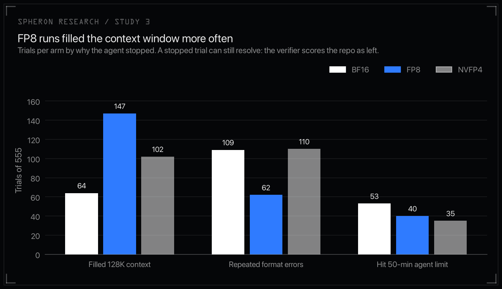

# Does NVFP4 hurt a coding agent? GLM-5.3-Flash BF16 vs FP8 vs NVFP4 on SWE-rebench

Spheron Research, study 3. Measured 26-27 Nov 2026 on one 8x NVIDIA B200 node (spot) on Spheron. Version 1.

## Findings

- **Neither FP8 nor NVFP4 lost measurable accuracy against BF16.** On 111 fresh SWE-rebench tasks, 5 runs each, GLM-5.3-Flash in BF16 resolved 62.9% of trials. The official FP8 checkpoint resolved 63.2%, a paired difference of +0.4 points (95% interval -3.8 to +4.5). NVIDIA's NVFP4 checkpoint resolved 65.6%, +2.7 points (-1.6 to +7.0). Both lower bounds clear the pre-registered -5 point margin, so both pass as "no measurable loss". Neither is a measured gain: both intervals cross zero.
- **NVFP4 used the least node time per resolved trial on 8x B200.** It left the most room for KV cache (10.9M tokens against 6.4M for BF16 and 9.6M for FP8, all with a BF16 cache) and used 0.91 node-minutes per resolved trial, against 1.02 for BF16 and FP8. Mean GPU power was 366 W for NVFP4, 383 W for FP8 and 452 W for BF16.
- **FP8 runs filled the 128K context window more than twice as often as BF16:** 147 trials against 64, +15.0 points per task (95% interval +10.5 to +19.6). It was not wordier. It wrote fewer output tokens per call than BF16 (288 against 324) and stopped less often on repeated format errors (62 trials against 109), so its runs went on longer and more of them reached the roughly 150 calls that fill 128K. Half of FP8's context-limited trials still resolved, because the verifier scores the repository as the agent left it.
- **Pass@5 was 83.8% for BF16, 88.3% for FP8 and 89.2% for NVFP4.** Per-run resolved rates ranged 59.5% to 65.8% for BF16 over the same tasks, a spread wider than the differences between precisions.
- **Our planned calibration arm, GLM-5.2 FP8, was dropped.** On 8x B200 it got a KV cache of only 670,208 tokens, about five 128K contexts, and most trials ran out of their 50-minute agent limit at any concurrency we tried. That score would have measured memory, not the model. So this study compares precisions only and makes no claim against closed models on the SWE-rebench leaderboard.

## Paired difference against BF16


Each task is averaged over its 5 runs, then the quantized arm's task mean minus BF16's. The interval comes from 10,000 bootstrap resamples over tasks (seed 0).

| Scope | Arm | Difference vs BF16 | 95% interval | Verdict |
|---|---|---:|---|---|
| All 111 tasks | FP8 | +0.4 pts | -3.8 to +4.5 | No measurable loss |
| All 111 tasks | NVFP4 | +2.7 pts | -1.6 to +7.0 | No measurable loss |
| 108 offline tasks | FP8 | +0.0 pts | -4.3 to +4.3 | No measurable loss |
| 108 offline tasks | NVFP4 | +2.4 pts | -1.7 to +6.7 | No measurable loss |
| Trials with an out-of-memory signal removed (110 tasks) | FP8 | -0.3 pts | -4.8 to +4.2 | No measurable loss |
| Trials with an out-of-memory signal removed (109 tasks) | NVFP4 | +3.2 pts | -1.2 to +7.7 | No measurable loss |

The rule was fixed before the run: no measurable loss if the lower bound is above -5 points, a loss if the upper bound is below 0, inconclusive otherwise.

## Results

### Resolved rate

| Arm | Checkpoint | Resolved | Rate | SEM (5 runs) | Per-run rates | pass@5 | Resolved in all 5 |
|---|---|---:|---:|---:|---|---:|---:|
| A, BF16 | `zai-org/GLM-5.3-Flash-BF16` | 349 / 555 | 62.9% | 1.2 | 59.5, 60.4, 65.8, 64.9, 64.0 | 83.8% | 34.2% |
| B, FP8 | `zai-org/GLM-5.3-Flash` | 351 / 555 | 63.2% | 1.0 | 65.8, 64.9, 64.0, 60.4, 61.3 | 88.3% | 31.5% |
| C, NVFP4 | `nvidia/GLM-5.3-Flash-NVFP4` | 364 / 555 | 65.6% | 1.5 | 61.3, 63.1, 69.4, 67.6, 66.7 | 89.2% | 35.1% |

Runs are each task's 1st to 5th attempt by start time. Pass@5 is the share of tasks resolved at least once.

### By language

Descriptive only: 20 to 25 tasks per language is too few to test.

| Language | Tasks | BF16 | FP8 | NVFP4 |
|---|---:|---:|---:|---:|
| Go | 21 | 80.0% | 78.1% | 78.1% |
| Java | 21 | 54.3% | 64.8% | 68.6% |
| Python | 20 | 60.0% | 55.0% | 61.0% |
| Rust | 25 | 46.4% | 49.6% | 52.8% |
| TypeScript | 24 | 75.0% | 70.0% | 69.2% |

### Why the agent stopped



Trials per arm, with how many of them still resolved in brackets. Read from each trial's own log.

| Stop reason | BF16 | FP8 | NVFP4 |
|---|---:|---:|---:|
| Submitted | 301 (230) | 266 (211) | 280 (235) |
| Repeated format errors | 109 (52) | 62 (24) | 110 (48) |
| Filled 128K context | 64 (27) | 147 (74) | 102 (49) |
| Hit 50-minute agent limit | 53 (24) | 40 (23) | 35 (19) |
| Hit 250-step limit | 14 (10) | 18 (9) | 8 (6) |
| Model endpoint error | 3 (3) | 2 (2) | 3 (2) |
| Other agent exit | 11 (3) | 20 (8) | 16 (5) |
| Verifier error | 0 (0) | 0 (0) | 1 (0) |

The one verifier error (`ubugeeei-prod__vize-774`, NVFP4) is counted as unresolved.

What sits behind the context-limit gap, at the point each trial hit 128K:

| Arm | Context hits | Tasks with a hit | Median model calls at the hit | Median model text at the hit, chars | Median tool output at the hit, chars | Trials that reached 150 calls | Median output tokens per call, all trials |
|---|---:|---:|---:|---:|---:|---:|---:|
| BF16 | 64 | 44 | 150 | 122,968 | 276,369 | 72 | 324 |
| FP8 | 147 | 64 | 150 | 105,046 | 289,325 | 119 | 288 |
| NVFP4 | 102 | 55 | 142 | 112,342 | 289,441 | 98 | 287 |

A run fills 128K at about 150 calls whatever the precision. FP8 trials simply got there more often. The tasks where FP8 hit the limit most often relative to BF16 were `microsoft__apm-1553` (BF16 1 of 5, FP8 5 of 5), `cloudflare__vinext-1837` (1 and 5), `kubernetes-sigs__kueue-11559` (0 and 4) and `ubugeeei-prod__vize-1508` (1 and 4).

### Throughput and power

Spot reclaims split two of the three arms across nodes, so wall-clock time per arm is not comparable. Instead we sum each arm's trial hours and divide by the 48 trials kept in flight.

| Arm | KV cache, tokens | Trial hours | Node hours at 48 | Node minutes per resolved trial | Median trial, minutes | Mean GPU power | Mean GPU use |
|---|---:|---:|---:|---:|---:|---:|---:|
| BF16 | 6,427,427 | 283.5 | 5.91 | 1.02 | 29.3 | 452 W | 84% |
| FP8 | 9,559,068 | 285.4 | 5.95 | 1.02 | 30.5 | 383 W | 81% |
| NVFP4 | 10,903,475 | 264.9 | 5.52 | 0.91 | 27.1 | 366 W | 81% |

- KV cache is vLLM's reported size at `--gpu-memory-utilization 0.85` with a BF16 cache. Model weights took 74.0 GiB per GPU for BF16, 38.4 GiB for FP8 and 23.0 GiB for NVFP4.
- Power and use are per GPU, sampled every 5 s while each arm ran.
- NVFP4 ran start to finish on one node in 6.0 h of wall time, which is 0.99 node-minutes per resolved trial.
- The workload is almost all prefill. In arm A's last segment, on one node, the engine read 889.8M prompt tokens and generated 4.9M, about 180 to 1. No request was preempted in any arm.

## What we did

- **GPU:** 8x NVIDIA B200 (179 GiB each), 160 vCPU, 1,792 GB RAM, driver 580.196.07, CUDA 13.0. Spheron, spot. A 4 TB network volume in the same region held the weights, task images and every trial's results, so a reclaim lost only trials in flight.
- **Engine:** `vllm/vllm-openai@sha256:0674a3ea3c971706cea310bca71daadff68ea1717c758d2f54affa5def001b86`, which reports `0.28.1rc1.dev580+g385dce36b`. Same flags for every arm, only the checkpoint changes: TP8 with expert parallel, `--kv-cache-dtype bfloat16` (vLLM would otherwise pick FP8 KV for the NVFP4 checkpoint), 131,072 context, 64 max sequences, chunked prefill, prefix caching on, GPU memory 0.85, `--seed 0`, GLM tool-call and reasoning parsing (`--tool-call-parser glm47`, `--reasoning-parser glm45`). Exact command in `stage1/raw/env/serve.sh`.
- **Checkpoints, pinned by commit:**
  - A `zai-org/GLM-5.3-Flash-BF16` `f9fed3bbc822`
  - B `zai-org/GLM-5.3-Flash` (FP8) `46a050bec130`
  - C `nvidia/GLM-5.3-Flash-NVFP4` `1d00738646cb`
  - C is NVIDIA's checkpoint, the one its model card reports numbers for. A community repack (`tattrongvu/GLM-5.3-Flash-NVFP4`) has more downloads; we did not test it.
- **Tasks:** SWE-rebench July 2026 window through Harbor 0.27.0, `ibragim-badertdinov/swe-rebench-07-2026@2026-07-r4`: 111 tasks (Go 21, Java 21, Python 20, Rust 25, TypeScript 24). Three need network access (`vize-1508`, `agents-5944`, `cli-printing-press-2002`), so the 108 offline tasks are also reported on their own.
- **Agent:** mini-swe-agent 2.4.6 through Harbor, with SWE-rebench's own July 2026 system prompt adapted to mini-swe-agent's commands (`stage1/swerebench_mini.yaml`). 128K context with no history compaction, as on the leaderboard. Step limit 250. Shell commands may run 600 s. Observations over 5,000 characters keep their first and last 2,500. Each task's own 50-minute agent limit applies. Temperature 1.0 and top-p 0.95, the model card's recommendation, for every arm.
- **Runs:** 5 attempts per task per arm (`harbor run -k 5`), 48 trials in flight, 555 trials per arm. Arms ran in the order NVFP4, FP8, BF16.
- **Statistics:** the pre-registered paired bootstrap above. Stop reasons, context-limit rate and format-error rate were pre-registered as secondary outcomes, reported per arm.
- **Pilot:** a 20-task pilot and two re-pilots on 2x B200 set the agent config and the concurrency. See `PILOT.md`.
- **Scripts:** `stage1/raw/env/` (node setup, serving, the per-arm runner, recovery after each reclaim). `stage1/analysis/analyze.py` rebuilds every CSV in `results/` from the trial folders; `harness/charts.py` draws the charts from those CSVs.

## Caveats

- **This is not the SWE-rebench leaderboard's scaffold.** The leaderboard runs its own agent, which is not public. Ours is mini-swe-agent with their prompt. Absolute resolved rates here are not comparable with leaderboard rows. The comparison between precisions is, because every arm ran the same agent, prompt, tasks and limits.
- **Contamination.** Every task in this window predates GLM-5.3-Flash's release on 25 Aug 2026, so its absolute scores may be inflated. That affects all three arms alike and does not bias the precision comparison.
- **The context limit caps every arm.** 11.5% to 26.5% of trials filled 128K. Rust and TypeScript tasks account for 194 of the 313 hits across the three arms. The leaderboard's own agent reads files through a 100-line window and overflows far less often (about 3% in the trajectories we checked). A scaffold that compacts history or reads files in smaller pieces could change both the absolute rates and the FP8 context-limit gap.
- **"No measurable loss" means no loss larger than about 4 points.** The intervals are about ±4 points wide. A real loss of 1 to 3 points would not show up at 111 tasks.
- **NVFP4 scoring 2.7 points higher is not a finding.** Its interval crosses zero, and per-run rates within a single arm spread over 6 points. We report it, we do not claim it.
- **Temperature 1.0.** Runs differ by sampling, which is why there are 5 per task. Greedy decoding could rank the arms differently.
- **Out-of-memory kills inside task containers.** Each task container was capped at 16 GB. 52 to 66 trials per arm show a kill or allocation failure in their logs, Rust tasks most often (72 of 174). Removing those trials leaves the verdicts unchanged (table above). The match is on log text, not the kernel log, which was not kept per trial.
- **One GPU type.** Every arm ran on Blackwell, which runs NVFP4 natively. On Hopper, which has no FP4 hardware, NVFP4 would be slower and its throughput advantage could shrink or reverse.
- **Spot reclaims.** Six reclaims interrupted the run. Trials cut by a reclaim were rerun, not scored (see deviations). Every scored trial has a normal verifier result.

## Deviations from the plan

We publish these so the numbers can be judged with them in mind.

1. **Arm D (GLM-5.2 FP8), the calibration arm, was dropped,** and with it the comparison with closed models on the leaderboard. At 48 in flight, 48 of its first 50 trials hit the 50-minute agent limit. At 16 in flight with 2 attempts per task, 9 of its first 20 still did. vLLM gave it a KV cache of 670,208 tokens on 8x B200, against 6,427,427 for BF16 GLM-5.3-Flash, so long histories were evicted and re-read over and over. None of its trials is scored or published. Optional arm E (GLM-5.2 NVFP4) was not run.
2. **Agent config changed after the pilot.** The plan said step limit 150, 60-minute wall limit and mini-swe-agent's defaults. The pilot found 40% of trials filling 128K and builds being polled around mini-swe-agent's 30-second command limit, so Stage 1 used SWE-rebench's prompt, step limit 250, a 600-second command limit and 5,000-character observations. The wall limit is each task's own 50 minutes. All arms used the same config.
3. **KV cache forced to BF16 for every arm.** NVIDIA's NVFP4 recipe casts the KV cache to FP8, and vLLM picks that by default. We kept one KV dtype so only the weights differ between arms.
4. **vLLM version.** The plan assumed 0.29.0. The image that supports GLM-5.3-Flash reports `0.28.1rc1.dev580`, pinned by digest for every arm. `transformers` was upgraded to 5.16.1 or later inside the container at start, as the image required.
5. **Seeds.** The plan said seeds 0 to 4 per run. Harbor's `-k 5` does not set or record a per-attempt seed, so runs are numbered by start time. The vLLM server ran with `--seed 0`.
6. **Spot reclaims and reruns.** Nodes were reclaimed during arms C, B (three times) and A, and once during arm D, plus one node reclaimed before it finished booting. On the first node the work directory was on local disk, so arm C's 162 finished trials were lost and arm C was run again in full on the second node. After that everything lived on the volume. Trials written up as failures in a node's last seconds (rate-limit, network and exit-code errors from the dying vLLM, no verifier reward) were set aside (not published) and rerun: 184 for FP8 over three reclaims and 62 for BF16. Each cutoff is in `stage1/RUNLOG.md`, and every trial before it has a normal verifier result.
7. **Task container memory set to 16 GB** (`--override-memory-mb 16384`) for every arm. The plan did not set it.
8. **4 TB volume, not 3 TB,** to hold the weights and the saved task images.
9. **Four trials have no verifier reward and are counted as unresolved.** Two filled the context window and then ended on an authentication error from the harness (`HKUDS__nanobot-4274`, FP8; `microsoft__apm-1553`, NVFP4). Two are on `ubugeeei-prod__vize-774`, NVFP4: one missing reward file and one non-zero agent exit.

## Raw data

- Study folder in the public Spheron Research repo, with the report, charts, scripts, results CSVs and `DATA.md` (what every column means): https://github.com/spheronai/research/tree/main/2026-11-26-swe-rebench-glm-quantization
- `results/trials_classified.csv` has one row per scored trial (1,665): task, language, attempt, resolved, stop reason, model calls, tokens and minutes.

Data under CC BY 4.0, scripts under MIT.

## How to cite

```
Spheron Research (2026). Does NVFP4 hurt a coding agent? GLM-5.3-Flash BF16 vs FP8 vs NVFP4 on SWE-rebench. Measured 26-27 Nov 2026, published 28 Nov 2026, version 1.
https://www.spheron.network/research/glm53-flash-bf16-vs-fp8-vs-nvfp4-swe-rebench/
Raw data: https://github.com/spheronai/research/tree/main/2026-11-26-swe-rebench-glm-quantization
```

```bibtex
@misc{spheron2026glm53quant,
  author       = {{Spheron Research}},
  title        = {Does NVFP4 hurt a coding agent? GLM-5.3-Flash BF16 vs FP8 vs NVFP4 on SWE-rebench},
  year         = {2026},
  note         = {Measured 26-27 Nov 2026, published 28 Nov 2026, version 1},
  howpublished = {\url{https://www.spheron.network/research/glm53-flash-bf16-vs-fp8-vs-nvfp4-swe-rebench/}}
}
```

## Changes

- 28 Nov 2026: version 1.
